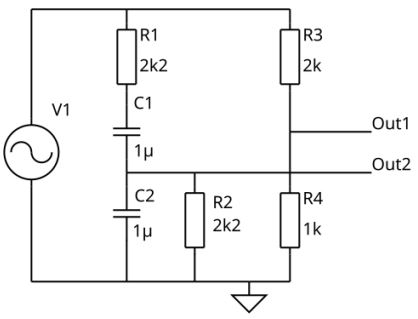

# Problem 840

Given the following circuit, what is the frequency with to maximum attenuation?\n
(Give your answer in Hz, round to two digit after the decimal points)\n
Please use the following format: 12.34

