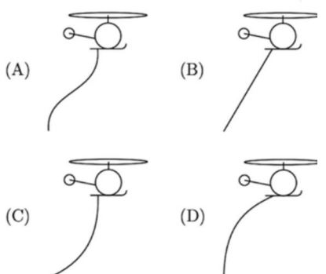

# Problem 914

A helicopter is flying horizontally at a constant speed. A perfectly flaxible and uniform cable is suspended beneath the helicopter. Air friction on the cable is not negligible. Which of the following diagrams best represents the shape of the cable as the helicopter flies through the air towards the right?

Options:
- A) D
- B) A
- C) C
- D) B
