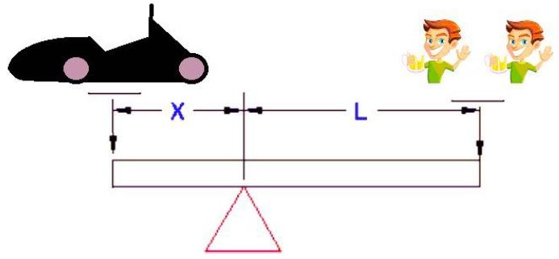

# Problem 725

You are at the FSBk after-party, and you want to win the mechanical advantage competition.Mechanical advantage.\n Use as many team members as you consider bringing the lever to equilibrium.\n CW (car weight) = 275.5 kg\n X = 1.1216 m\n L = 2 m\n You've decided to use two team members, TM1 = 71.3 kg ; TM2 = 78.6kg.\n Rules of the game:\n- the lever needs to be in equilibrium (level with the ground)\n- you can lose weight (murder, and dismemberment are prohibited)\n - you can gain weight only by drinking beer 1l=1kg\n - you can have a beer 0.7kg in hand while on the lever\n Knowing the above-mentioned, TM1 can drink 1.9 l/h; TM2 can drink 2.4 l/h, being a competition, they need to drink fast.\n How much weight do they need to gain/lose in the shortest time possible to bring the lever in equilibrium?

Options:
- A) Gain 3.2kg – 44min39sec
- B) Gain 2.3kg – 41min41sec
- C) Loose 2.3kg – 45min47sec
- D) Gain 3.2kg – 32min32sec
