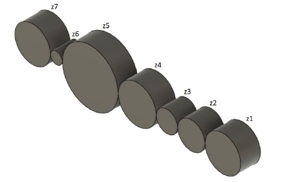

# Problem 736

For the shown gear train, the input RPM is 3600, and the number of teeth of the input gear is z1=30.\n The number of teeth of the rest of gears are: z2=23, z3=18, z4=32, z5=47, z6=10, z7=30.\n Calculate the RPM of the final gear z7.\n (answer format round to nearest decimal eg:12.34)

