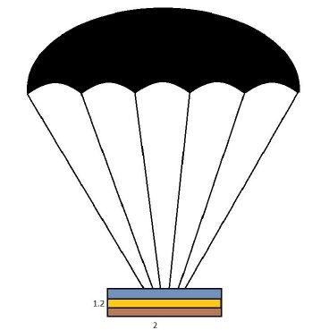

# Problem 741

Cargo Drop. Because of time constraints, you decide to parachute your car and tools. All of them will be placed in a box 2 x 1.7 x 1.2 m from 1000 m height weighing 500 kg. Knowing that the parachute must open at 50m above the ground. At what time the parachute must open from the time it is being dropped, what is the total time of descent, knowing the descent velocity with the parachute open of 3.5 m/s, and what is the parachute diameter?\n (the parachute has no delay on opening, earth gravity acceleration= 9.81 m/s2, drag coeficient of the box= 1.05, drag coefficient of the assembly = 1.35, air density= 1.204 kg/m3)

Options:
- A) time to open the parachute 23.75 s; time of total decent 38.03 s; radius 12.52 m.
- B) time to open the parachute 38.03 s; time of total decent 58.75 s; radius 18.52 m.
- C) time to open the parachute 13.75 s; time of total decent 28.03 s; radius 8.52 m.
- D) time to open the parachute 43.03 s; time of total decent 48.75 s; radius 2.52 m.
