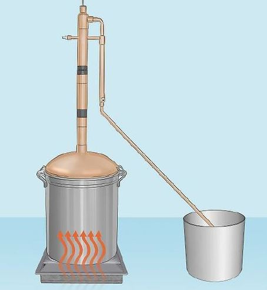

# Problem 744

You are a provider of E85 for the formula student Balkans competition. You must provide E85 fuel for 20 teams for the 2024 event. Knowing that one team uses 16 liters of E85 for the whole event (practice included). You decide to make it in the Balkan way, so how many kg of fruits you must collect in order to obtain the required amount of E85 fuel, knowing that from 25kg of fruits (plums, bananas, apricots, etc.) you get around of 8 liters of pure ethanol. You will also have to find how many barrels of 50kg do you need to deposit the fruits.

Options:
- A) 850kg of fruits; 17 barrels
- B) 800kg of fruits; 17 barrels
- C) 900kg of fruits; 18 barrels
- D) 950kg of fruits; 18 barrels
