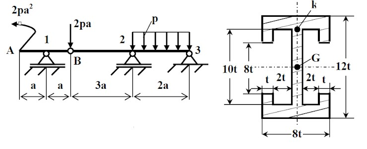

# Problem 994

For the straight beam illustrated in figure, featuring an internal hinge at point B and the given cross-sectional geometry, knowing p = 20 kN/m, σa = 160 MPa, a = 60 cm, determine the required dimension t.

Options:
- A) t = 9.028 mm
- B) t = 8.902 mm
- C) t = 9.128 mm
- D) t = 9.328 mm
