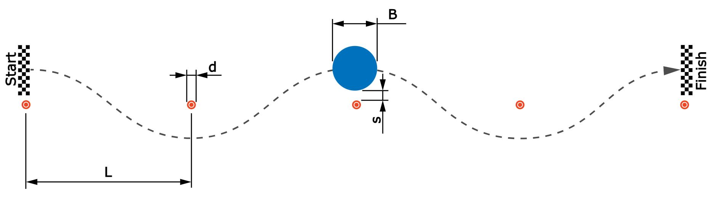

# Problem 1024

Calculate how the travel time of a vehicle through a slalom course changes when the vehicle width is varied. Take aerodynamic downforce into account.
- The slalom consists of 5 cones. Entry and exit are on the same axis (congruent).
- The distance L between the cones is 6 m.
- The diameter d of the cones is 0.23 m.
- The driver maintains a safe distance s of 0.3 m from the cones.
- The vehicle’s width B is 1.3 m
- The aerodynamically effective length aL is 1.6 m.
- The coefficient of friction between the tires and the road surface u is 1.22.
- The coefficient of downforce cL is -2.1.
- The vehicle mass m is 247 kg.

The following simplifications are to be made:
1. The vehicle drives through the slalom course in constant circular arcs at a constant speed.
2. The vehicle is approximated as a cylinder with diameter B.
3. The aerodynamically effective area is calculated as B x L.
4. The coefficient of downforce cL should be constant across all variants.

How does the driving time change due to the slalom when the vehicle width is changed by delta B=0.05 m compared to the reference vehicle with width B? Positive delta B means a wider car. Less traveltime means negative time difference.

Enter the time difference in seconds with 2 decimal places.

