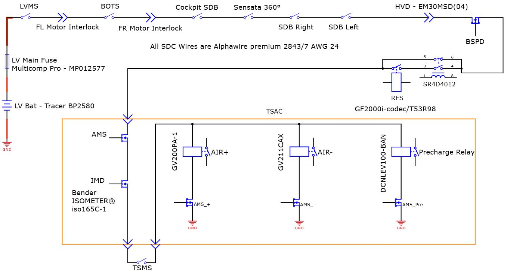

# Problem 1025

Your 2026 vehicle is described by the schematic above. Your LVS voltage is 24V unregulated. The media team wanted a completely black vehicle for your rollout and spraypainted your shutdown buttons (SDBs) black. You forgot about it until now and have Technical Inspection coming up in 30 minutes. You go to the closest industry supply store and find that they only have the following buttons in stock.

Select all which are suitable to be used as side SDBs.

Options:
- A) IDEC XA1E-BV4U02-R
- B) RAFI 1.15.154.006/0301
- C) KISSLING ES-2011-T112
- D) None of these are compliant
- E) EAO 61-6461.4087
- F) OMRON A22NE-MP-PD020-N
