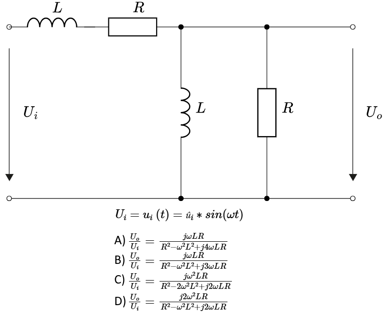

# Problem 1026

Consider the network above, where the input voltage is a harmonic alternating voltage.
Determine the transfer function. Which of the following equations is CORRECT?

Options:
- A) A
- B) B
- C) C
- D) D
