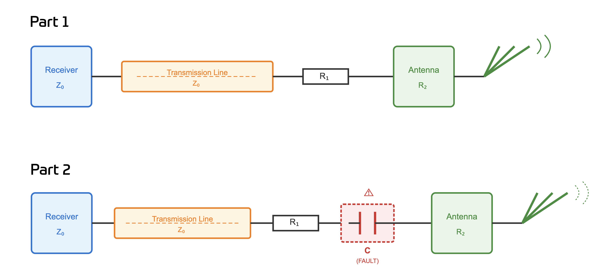

# Problem 1029

# Part 1 The Remote Emergency System (RES) of your vehicle uses a wireless communication link operating at frequency
f = 433 MHz and Z0 = 50 Ω. The system consists of a receiver connected to an antenna via a coaxial transmission line (
Z0 = 50 Ω). The antenna connector has a resistance R2 = 45 mΩ. The transmission line has a resistance R1 = 85 mΩ. The
distance from the antenna to the receiver is 25.5 λ. All component tolerances are negligible and we assume the conditions in
vacuum. Calculate the complex impedance and Voltage Standing Wave Ratio (VSWR). Round to two decimals.

# Part 2 During a
test run, moisture ingress causes a capacitive fault in the antenna connector. This introduces an additional series capacitance C
between the series resistance R1 and the antenna R2. We assume the capacity has 9 pF. Calculate the complex impedance and
VSWR. Round to two decimals.

Answer format: Part1 Real, Part1 Imaginary, Part1 VSWR, Part2 Real, Part2 Imaginary, Part2 VSWR

