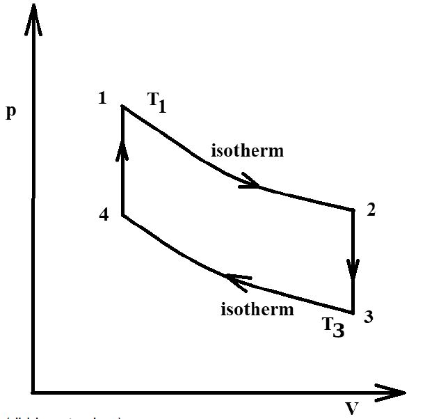

# Problem 155

In the illustrated thermodynamic cycle of an ideal gas, the values for p1=6.5bar, V1=0.7m3, V2=2.1m3, p4=1.2 bar and T1=800K are given.
The value T3 is to be calculated in Kelvin! Round solution to one decimal place.

