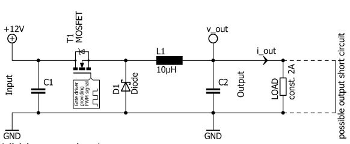

# Problem 156

The following electric circuit may be used to convert an input voltage to a different output voltage to supply a load ("switched mode power supply"). The input voltage is 12V, the load draws a constant current of 2A (independent of the output voltage).
The MOSFET is turned on and turned off periodically, according to a pulse width modulated (PWM) control signal. The switching frequency is 250kHz. The duty cycle (ratio of the turn on time of the MOSFET to period time) is used to control the output voltage. The switching losses of the MOSFET are neglectable. In turned on condition, the MOSFET can be assumed to have constant resistance drain to source (Rdson). The diode can be assumed to be ideal (zero forward voltage, zero switching losses, zero reverse recovery, ...). The inductor is formed by windings on a ferromagnetic core. The core reaches saturation at current values higher than those occurring during normal operation. All voltages are referenced to ground ("GND").
Which of the following statements about the circuit is true? There is only one correct statement!

Options:
- A) In steady-state operation, the circuit can only provide output voltages (v_out) that are higher than the input voltage (12V).
- B) In case of output short circuit, the magnetic flux in the ferromagnetic core of the inductor reaches its saturation value. This leads to intrinsic limitation of the output current (i_out) in case of output short circuit.
- C) The power dissipation of the circuit is given by Pdissipation = |12V - v_out| · i_out.
- D) When decreasing the output voltage (v_out) at constant output current (i_out), the power losses due to the Rdson of the MOSFET increase.
- E) When increasing the output voltage (v_out) at constant output current (i_out), the power losses due to the Rdson of the MOSFET increase.
