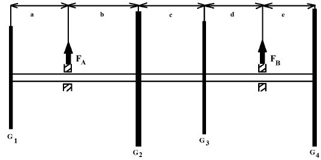

# Problem 157

The shown gears have weight forces of G1=40N, G2=60N, G3=35N, G4=55N. The weight of the shaft can be neglected. The distances are as follow: a=110mm, b=100mm, c=150mm, d=120mm and e=55mm.
Please calculate the force in bearing point FB in Newton! Round the solution to one decimal place.

