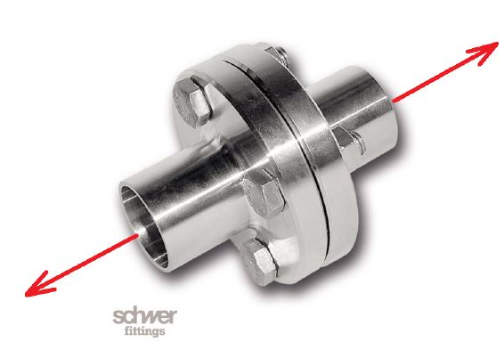

# Problem 158

The coupling of two rods with a tensile load of 80 kN is realized by flanges which are connected by 4 screws. All screws are oriented in the direction of the tensile load. Which screw core diameter must be at least present if the allowable tension stress is 32N/mm2?
Enter the result of the screw core diameter in millimeter. Round solution to one decimal place.
Enter the minimal possible ISO metric screw thread according to DIN 13-1 (Column 1, First Choice) / ISO 262 (Column 1, First Choice): (Mxx)
Give your answer in the following format: screw core diameter, ISO metric screw thread. Example: if the screw core diameter is 12,3mm and the ISO metric screw thread is M12 then use 12.3, 12 as answer value.

