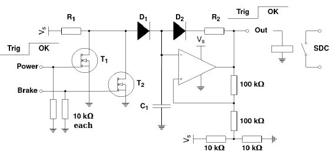

# Problem 159

The given circuit shows an implementation of a BSPD latch.
Evaluate the time to trigger: transition of both inputs from Vs to 0V. State the results in milliseconds. Round to one decimal place.
Evaluate the time to reset: transition of both inputs from 0V to Vs. State the results in seconds. Round to one decimal place.

The following conditions are assumed:
Vs = 5V
R1 = 68kΩ
R2 = 2.2MΩ
C1 = 3.3μF
ideal Diodes with constant Vf = 0.7V and Ir = 0A
FETs as ideal "switches" with Vth somewhere between 1V and 4V, Rds_on = 0Ω and Ices = 0A
ideal operational amplifier
at least on trigger and reset cycle already occurred before
the circuit has reached steady state before the input transition
there is an input conditioning circuit evaluating hard braking and respective power delivery or throttle position with digital
outputs which is not shown in the schematic
both digital inputs have always exactly the same logical state which is either 0V, trigger conditition, or Vs, idle

Give your answer in the following format: time to trigger, time to reset. Example: if the time to trigger is 1234,5ms and the time to reset is 12,3s then use 1234.5, 12.3 as answer value.

