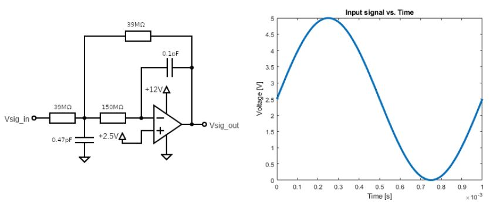
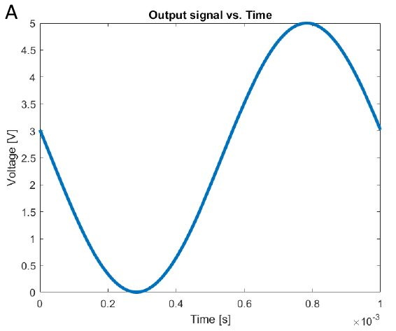
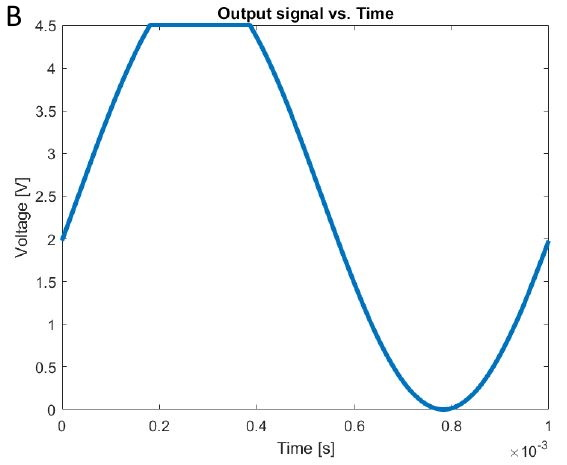
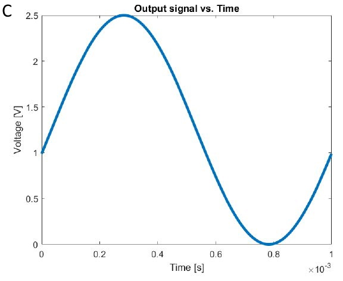
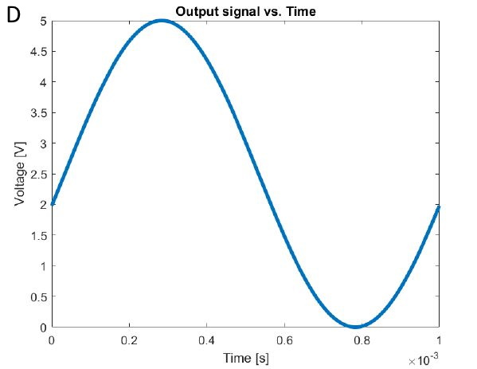
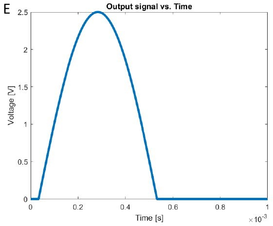
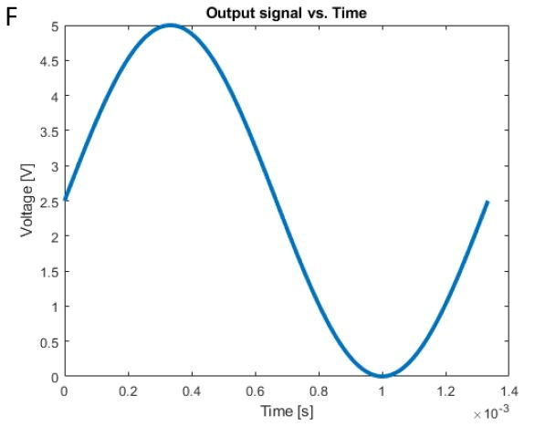
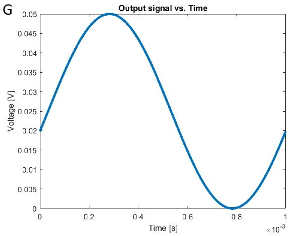
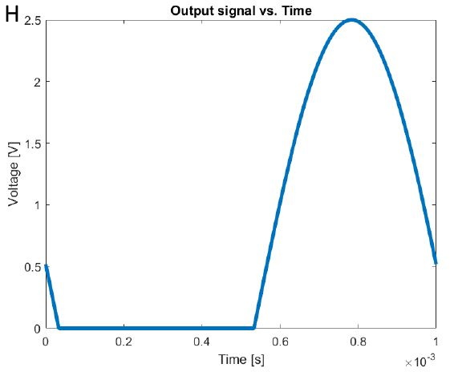

# Problem 161

Your suspension team member wants you to measure a certain signal. You encounter quite some noise and want to filter the higher frequencies out that are not of interest and opt for the following active low pass filter configuration (multiple feedback filter) and the given input signal. All components are assumed to be ideal.
What will be the output signal?

Options:
- A) A
- B) B
- C) C
- D) D
- E) E
- F) F
- G) G
- H) H
