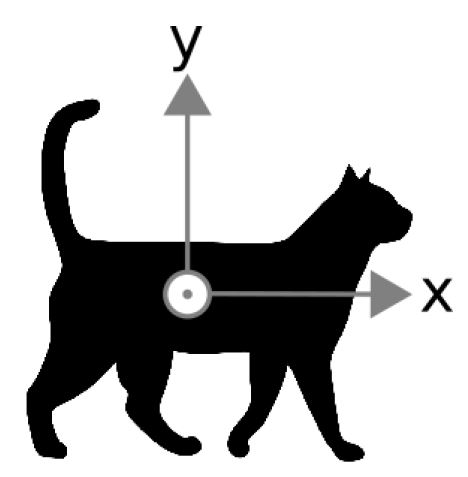

# Problem 165

The cat of a FSG technical inspector falls down from the fifth floor balcony (15m height to ground). The cat is oriented with its back downwards to the ground when starting to fall with no initial rotational or translational speed. Using the inertia of the tail, the cat tries to turn around the x-axis, see figure for definition, until the feet point downwards. How long does it take to turn? How long does the cat fall?
The cat is assumed to have a mass of 1.5kg. The tail has an rotational moment of inertia around the x-axis of 1.125gm2, the rest of the cat without the tail has an rotational moment of inertia around the x-axis of 4.8gm2. The tail has a maximum rotational angular speed of 2π rad/s around the x-axis. It is assumed, that the tail can be accelarated in no time. The aerodynamic drag coefficient is assumed to be cw = 0.8 independently of the orientation around the x-axis. The cats aerodynamic cross sectional area is given by 0.04m2, independently of the orientation around the x-axis. The air density is assumed to be 1.2kg/m3, the gravitational accelaration is defined to be 9.9m/s2.
Please enter:
- the time needed until reaching the ground in seconds rounded to the nearest two decimals.
- the time needed to turn on the feet in seconds rounded to the nearest two decimals.
Give your answer in the following format: time needed until reaching the ground, time needed to turn on the feet. Example: if the time needed until reaching the ground is 12,34s and the time needed to turn on the feet is 23,45 then use 12.34, 23.45 as answer value.

