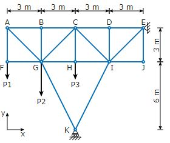

# Problem 431

The truss structure shown in the figure is loaded at joints F, G and H as shown. The truss structure is supported in points E and K as shown. Each segment of the truss structure is assumed to have no mass and infinite stiffness.\n Identify the obvious zero-force members in the structure under the given load and indicate them by placing a check-mark!

Options:
- A) AB
- B) AG
- C) AF
- D) BC
- E) BG
- F) CD
- G) CG
- H) CH
- I) CI
- J) DE
- K) DI
- L) EI
- M) EJ
- N) FG
- O) GH
- P) GK
- Q) IJ
- R) IK
