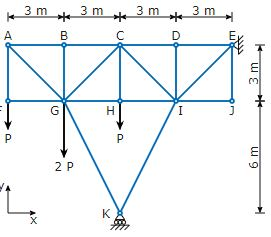

# Problem 432

The truss structure shown in the figure is loaded at joints F, G and H as shown. The truss structure is supported in points E and K as shown. Each segment of the truss structure is assumed to have no mass and infinite stiffness.\nCalculate the reaction force Ey at Point E in y-direction in multiples of P! Round the solution to one decimal place.

