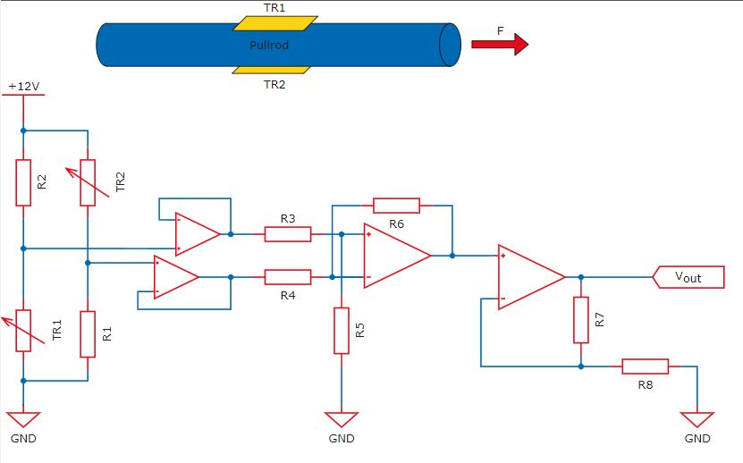

# Problem 433

The force F acting on a pull rod shall be measured as shown in the figure by two strain gauges TR1 and TR2, both having a gauge factor of 2. The length of the pull rod is 400 mm the diameter is 12 mm. The tensile modulus is 220 GPa. The schematic shows the used electric circuit.The following conditions are assumed:
F = 250 N
R1 = R2 = 120 Ω
R3 = R4 = 1 kΩ
R5 = R6 = 200 kΩ
R7 = 100 kΩ
R8 = 1 kΩ
Vout = 0 V for F = 0 N
temperature is constant
operational amplifiers are ideal
Calculate the output voltage Vout! Round the solution to two decimal places.

