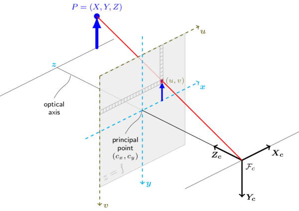

# Problem 434

Your vehicle has its right-hand base coordinate frame defined with the x-axis pointing forward into driving direction and z-axis upwards. A camera is positioned in the vehicle with respect to the vehicle coordinate system as follows:
x = 500 mm
y = 160 mm
Z = 1140 mm
and the Euler angles ZY′X′′
roll = 100°
pitch = 0°
yaw = 90°
Assume the camera has no distortion, a resolution of 1280 px x 1080 px and the principal point (cx and cy) and the focal lengths (fx and fy) are given by:
cx = 636 px
cy = 548 px
fx = 241 px
fy = 238 px
The point (u, v)0 is defined to be (u, v)0 = (-cx, -cy) as commonly used. Within the camera image plane (z axis in viewing direction), an object (center) is detected at pixel:
u = 872 px
v = 423 px
Another sensor determines the distance (euclidian) of the object with respect to camera frame:
d = 1.9 m
Calculate the position (3D) of the object with respect to the vehicle frame in meter! Round the solution to three decimal places. Give the solution in the following format: x, y, z, e.g. 1.234, 5.678, 9.012

