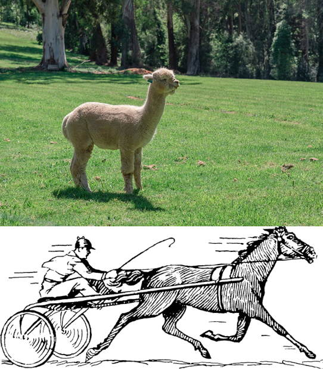

# Problem 447

Fred, FSG's race alpaca, does a skidpad event according to D 4 while pulling a driver on a typical single axis two-wheel sulky, a lightweight cart used for horse races. The sulky always moves on the center of the track. The axis of the center of both wheels always points to the circle's center. The wheels have an dynamic outer diameter of 42 cm. The sulky track width is 1.5 m.\n Calculate the difference in the number of turns of the right wheel compared to the left wheel after the skidpad! \nRound the solution to one decimal place.

