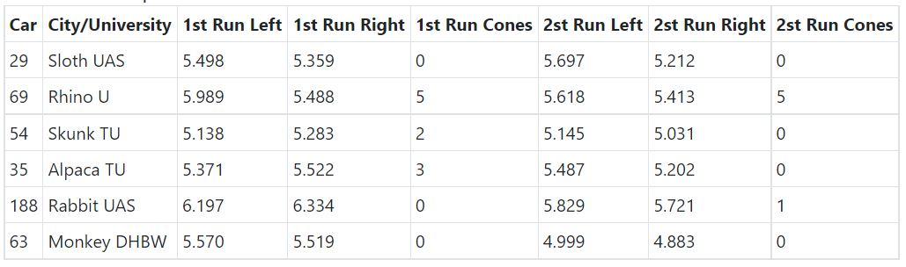

# Problem 450

Driverless skidpad results:
The given table showns the results of the driverless FSE skidpad event. Only the shown six teams are part of the competition.
Calculate the points for the team from the „Alpaca Technical University“ for normal driverless mode FSE skidpad scoring and for the Driverless Cup skidpad scoring! Round the solution to one decimal place. Give the solution in the following format: Driverless FSE Scoring, Driverless Cup Scoring, e.g. 1.2, 3.4
All times are in seconds:

