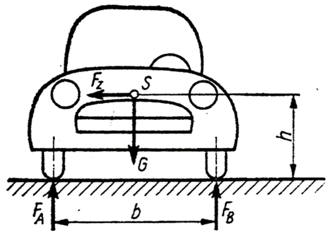

# Problem 515

A car with a total gravitational force of G = 2060 N (m=210 kg) has its center of gravity (S) at h = 205mm above the ground and is driving in a corner with a speed of 40 km/h. The corner has a radius (center of the track) of r = 14.5m. The track width b = 1240 mm. What is the maximum speed (in km/h) befor the car will roll over in this corner?\n The friction coefficients of the tires can be ignored and it may be assumed that the suspension, tires and damping are abolutely stiff. Give the answer in km/h and round the answer to the nearest tenth.

