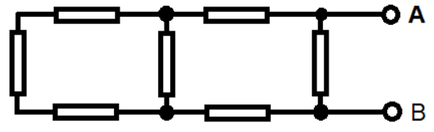

# Problem 516

Calculate the total resistance in Ohm of the shown electrical circuit between point A and B if each of the shown resistors have a value of R = 3 Ω.\n Give the answer in Ohm and round the answer to a tenth.

