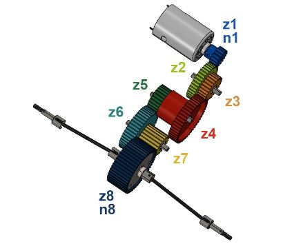

# Problem 612

For the shown drive train, the input rotational speed is 3600 min-1, and the number of teeth of the sprocket is z1 = 20.\n ease note: n2 = n3, n4 = n5, n6 = n7.\n The number of teeth of the sprockets are:\n z1 = 20, z2 = 45, z3 = 24, z4 = 55, z5 = 30, z6 = 43, z7 = 15, z8 = 53\n Calculate the rotational speed in min^-1 for the final sprocket z8 where the driveshafts are mounted. Round to one decimal.

