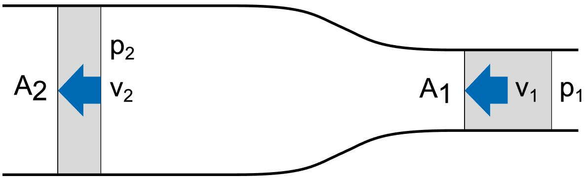

# Problem 613

A horizontal pipe increases from cross-section 1 with A1 = 2.55 cm2 to cross-section 2 with A2 = 7.1 cm2. In cross-section 1 there is a pressure of p1 = 1.2 bar and a flow rate of v1 = 5 m/s. The density of water is 997 kg/m3.\n Calculate the pressure in bar in cross-section 2 for the flowing water. Round to two decimals.

