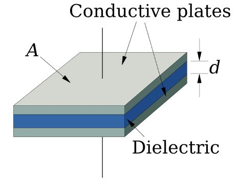

# Problem 614

Given is a parallel-plate capacitor with area A, separated by a uniform gap of thickness d1 filled with a dielectric with permittivity ε. At time t1, the voltage of the capacitor is V1. The capacitor is not connected to any electrical network.\n How much energy is needed to change the plate spacing to d2 = 4 × d1?

Options:
- A) -3εAV12/(4d1)
- B) 3εAV12/(4d1)
- C) -3εAV12/(2d1)
- D) 3εAV12/(2d1)
