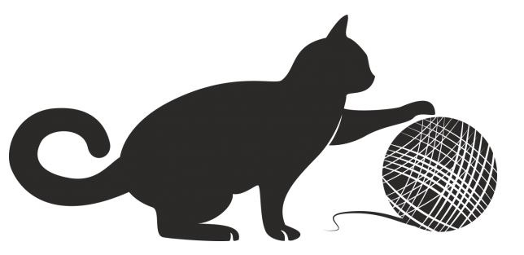

# Problem 615

Coco, the three-legged cat with a mass of 3.5 kg, is standing still on a horizontal frictionless surface. While playing with a ball of yarn, having a mass of 0.05 kg, Coco kicks it backwards with one of her three legs so hard that the ball of yarn reaches a speed of 2.3 m/s.\n The resulting speed of Coco is:

Options:
- A) 0.033 m/s forwards
- B) 0.077 m/s forwards
- C) 0.033 m/s backwards
- D) 0.077 m/s backwards
- E) no answer is correct
