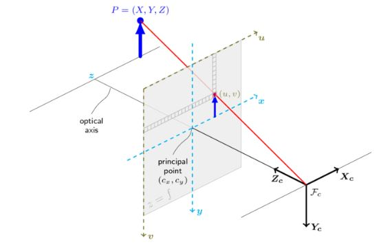

# Problem 616

Your vehicle has its right-hand base coordinate frame defined with the x-axis pointing forward into the driving direction and the z-axis upwards.\n A camera is positioned on the vehicle as follows, in the vehicle coordinate frame:\n x = 500 mm, y = 160 mm, z = 1140 mm\n and the Euler angles ZY′X′′\n roll = 100°, pitch = 0°, yaw = 90°\n Assume the camera has no distortion, a resolution of 1280 px × 1080 px, and the principal point (cx and cy) and the focal lengths (fx and fy) are given by:\n cx = 636 px, cy = 548 px, fx = 241 px, fy = 238 px\n The point (u, v)0 is defined to be (u, v)0 = (-cx, -cy) as commonly used.\n Within the camera image plane, z-axis in viewing direction, an object center is detected at pixel:\n u = 795 px, v = 467 px\n Another sensor determines the euclidian distance of the object to the camera frame as:\n d = 2.7 m\n Calculate the 3D position of the object in the vehicle coordinate frame in meter. Round to three decimals. Give the solution in the following format: x, y, z, e.g. 1.234, 5.678, 9.012

