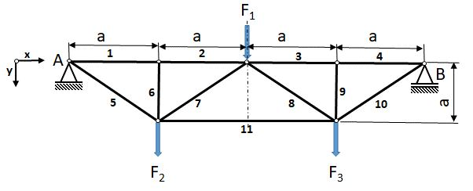

# Problem 618

The truss structure shown in the figure is loaded with the forces F1, F2 and F3. The truss structure is supported in points A and B, as shown. Each segment of the truss structure is assumed to have no mass and infinite stiffness.\n Identify the zero-force members in the structure under the given load and indicate them by placing a check mark.\n You may select one or more answers.

Options:
- A) 1
- B) 2
- C) 3
- D) 4
- E) 5
- F) 6
- G) 7
- H) 8
- I) 9
- J) 10
- K) 11
