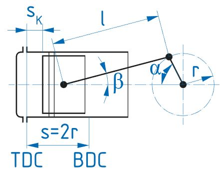

# Problem 621

A single-cylinder four-stroke engine with a total displacement of 623.7 cm3 has the following theoretical design: piston stroke s = 52 mm, connecting rod length l = 66 mm, piston diameter d = 38 mm. The ignition timing point is given as Sk = 2.0 mm before TDC.\n Calculate the ignition timing point in ° crankshaft before TDC. Round to one decimal.

