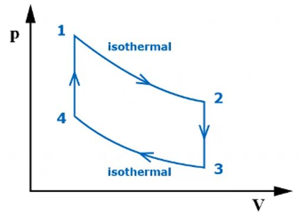

# Problem 66

In the illustrated thermodynamic cycle of an ideal gas, the values for pressure p1=7 bar and volume V1=0.6 m3 at point 1, volume V2=3.3 m3 and temperature T2=800 °C at point 2 and pressure p3=0,6 bar at point 3 are given. The volume at point 1 is the same as at point 4. The volume at point 2 is the same as at point 3. The pressure in point 4 is to be calculated in bar!
Round the solution to one decimal place.

