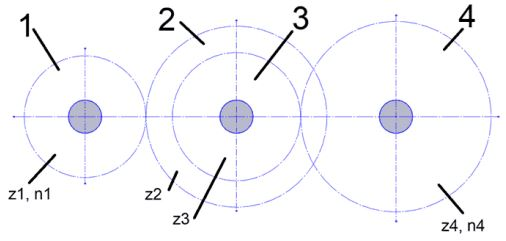

# Problem 664

Given is a schematic of a gearbox that consists out of two gear sets with the wheels 1 and 2 or 3 and 4 respectively. The wheels are fixed to their shafts. The number of teeth are given as Z1=25, Z2=75, Z3=15 and Z4=100. The drive speed of wheel 1 is given with 600 rpm.Calculate the drive speed of wheel 4 in rpm rounded to the nearest one.

