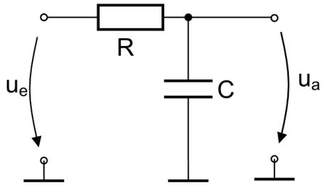

# Problem 665

Due to electromagnetic interference, a sensor signal is disturbed by a high frequency noise. To reduce this noise, you want to design a linear 1^st order low-pass Filter with a cut-off frequency at f0 = 300 Hz. What is the resulting phase shift of the sensor signal at f = 200 Hz?Give the result in degrees and round the result to the nearest tenth.

