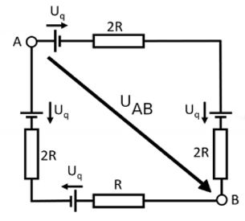

# Problem 67

Calculate the voltage UAB between A and B in multiples of Voltage Uq.
Enter the exact solution as a completely simplified and reduced fraction in the format numerator/denominator.
Numerator and denominator must be integers, e.g. 1/2

