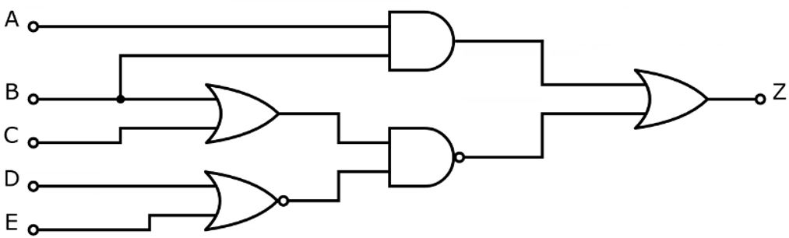

# Problem 69

A logic plan with the five logic valued inputs A, B, C, D and E is shown in the picture. The gates are drawn according to the commonly used ANSI/IEEE Std 91/91a-1991.
How mant possible input compinations result in a logic false at the output Z?

