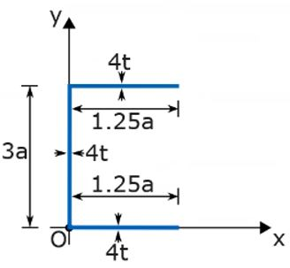

# Problem 70

A thin-walled (t ≪ a) cross-section is shown in the figure in gray. All relevant dimensions are given in the drawing. The drawing itself is not to scale. Calculate the second moment of area of the cross-section about the x-axis through point O using the thin-walled assumption and resulting simplification.
Enter the exact solution:

