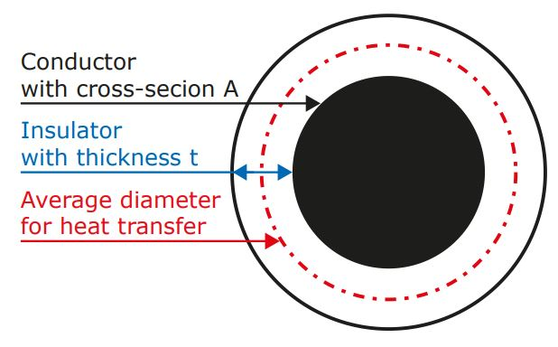

# Problem 71

Your team decides to use aluminum cables instead of copper to save weight. As there is no proper sizing table for these cables you try to calculate the proper fusing value yourself.
The cross-section of one cable is A.
You measured the thickness of the insulation which is t.
From previous experiments you know, that the cables will face a maximum ambient temperature of Tamb inside your vehicle and that the heat transfer coefficient between the wire and ambient through the insulator is λ.
The coefficient is estimated in relation to the average diameter of the conductor and the conductor with insulator.
Which fuse value must be chosen to have the maximum possible current without exceeding a temperature of Tmax inside the cable. The fuses are available in 1 A size steps.
The fuse is considered to be ideal, i.e. it trips immeadiately if the rated current is exceeded.
The resistivity of aluminum is assumed to be ρAL
The linear approximation for temperature dependence with the temperature coefficient α is used.
The following conditions are assumed:
cross section of cable A = 2 mm2
thickness of insulation t = 0.36 mm
maximum ambient temperature Tamb = 50 °C
maximum wire temperature Tmax = 70 °C
heat transfer coefficient between wire and insulator λ = 6 mW / (K * m)
resistivity of aluminum ρAL=26.4 nΩm
temperature coefficient α=0.0041 1/K

Enter the calculated fuse size.

