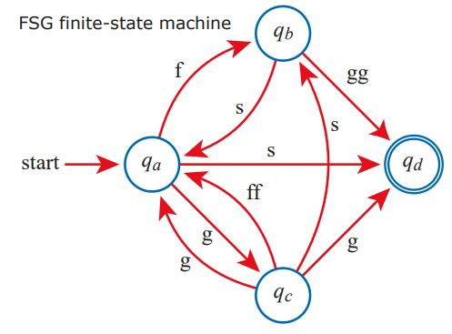

# Problem 73

The shown finite state machine is used to check if an input data stream matches with some regular expression. The data matches the regular expression if the final state qd is reached at the end of the input stream.
What regualar expression(s) will be checked by the state machine?
You may select one or more answers.

Options:
- A) ^([f|s|g]+(fs|gss|fs))*(fgg|s|gs[gg|s]*)$
- B) ^((g(ss|ff|g))|fs)*(s|((f|gs)?gg))$
- C) ^((g?(ss|g))|fs)+(s|gsgg|gg)$
- D) ^(gff|gss|ff|sf)*(fgg|gsgg|s|gg)$
