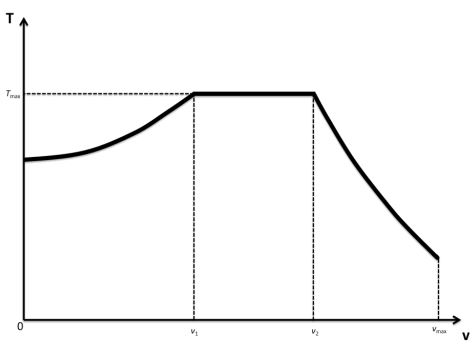

# Problem 75

An idealized FSE vehicle is driven by 4 identical, ideal wheel hub drives (no losses, no inertia) and has a weight distribution of 50/50.
The aerodynamic balance is 50/50 as well and independent from vehicle speed.
The following diagram shows the wheel torque (of one single wheel) T over the vehicle speed v for a perfect full accelaration without wheel slip.
Calculate v1 and v2 as shown in the picture in km/h.
Dynamic load transfer is neglected. The motor is assumed to be limited only by its maximum torque and maximum power.
Given parameters:
Vehicle mass m = 190 kg
dynamic rolling radius of each tire rdyn = 200 mm
aerodynamic lift coefficient of the vehicle cl = -1.25
aerodynamic cross sectional area of the vehicle A = 1.3 m2
tire friction coefficient μ = 1.2
gravity g = 9.81 m/s2
air density ρAir = 1.2 kg/m3
maximum wheel torque (each) Tmax = 130 Nm
maximum wheel hub drive power (each) Pmax = 20 kW
Round both solutions to one decimal place. Give the solution in the following format: v1, v2, e.g. 1.2, 3.4

