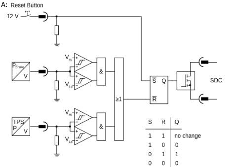
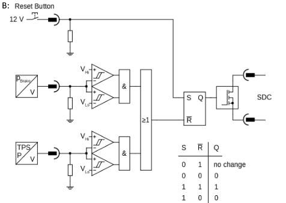
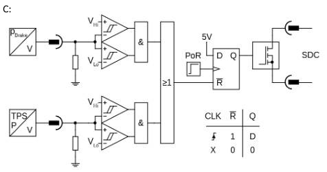
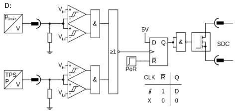
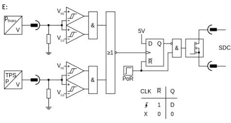

# Problem 78

Which Brake System Plausibility Device (BSPD) cricuit is allowed according to the rules? Assume the threshold voltages VHi and VLo to be properly set, and both the brake pressure sensor as wall as the tractive system current (P) / throttle position sensor (TPS) to have a positive slopw. The power-on-reset (PoR) signal is assumed to switch from low/false to high/true shortly after the power supply for the circuitry is turned on. If there is a high/true input signal to the MOSFET power stage, the MOSFET is in conducting mode. There is only one correct cirucut!

Options:
- A) A
- B) B
- C) C
- D) E
- E) F
