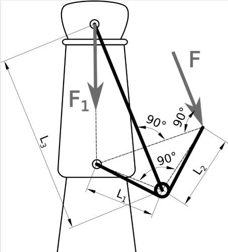

# Problem 80

To the lever on a swing-top beer bottle as shown in the picture a force of F = 30 N will be applied. Given are the three lengths L1 = 19 mm, L2 = 21 mm and L3 = 44 mm. Please calculate the Force F1 with which the cap is pressed to the bottles opening. Consider no movement occurs.
Enter the solution in Newton and round to whole numbers.

