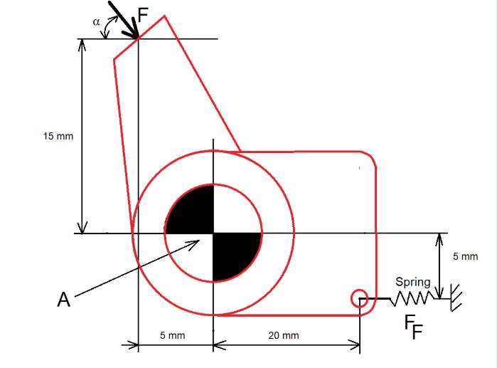

# Problem 81

A bell crank (as shown in the picure/ dimensions are not to scale) with bearing point [A] is applied with a force F=50N at an angle a=25°. Consider no movement occurse. Please calculate the absolute value of the force FF in the spring.
Enter the solution in Newton and round solution to one decimal place.

