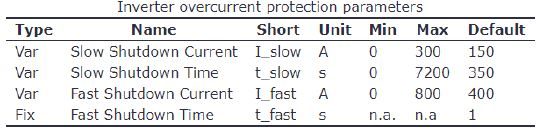
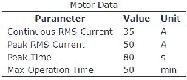
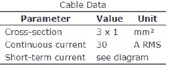
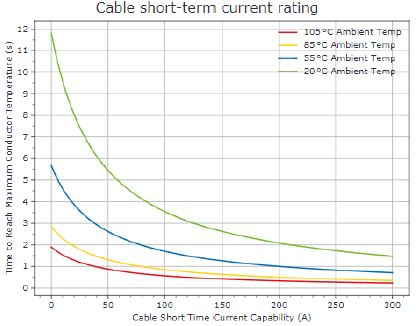

# Problem 841

You want ro replace the conventional fusing of your drive train's motors by using the programmable overcurrent protection of your Inverter. The motors as well as their connection cables shall be protected.\n According to the inverter's manual, there is a fast and a slow shutdown limit for short-term and long-term protection. The table below shows the respective parameters.\nThe measured current is compared to the threshold and a counter is counting upwards or downwards, depending on the comparator result. If the specified time is exceeded, the inverter output is shut down. \n Excerpts from your motor's and cable's data sheet are shown below. Note: If the maximum operation time is exceeded, the motor may be damaged. Please allow the machine to cool down before operating again.\n\nWhich parameters do you set in the motor controller software? Mark the correct answer.

Options:
- A) I_slow = 35A, t_slow = 3000s, I_fast = 80A
- B) I_slow = 30A, t_slow = 7200s, I_fast = 200A
- C) I_slow = 30A, t_slow = 3000s, I_fast = 80A
- D) I_slow = 30A, t_slow = 3000s, I_fast = 200A
- E) I_slow = 50A, t_slow = 3000s, I_fast = 80A
