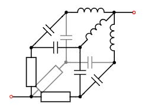

# Problem 842

Given is the three-dimensional circuit as shown. It consists of three resistors, each 4.7 kOhm, six capacitors, each 470 nF, and three inductors, each 4.7 μH.\nCalculate the magnitude of the impedance |z| in kOhm between the input and output marked in red for a sinusoidal voltage of 12V and 50 Hz between the input and output. Round to two decimals.

