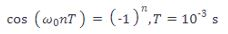

# Problem 843

The sequence x[n]=(-1)^n is obtained by sampling the continuouse-time sinusoidal signal x(t)= cos(w0t) at 1-ms intervals, i.e.,\n\nDetermine the three smallest distinct possible values of w0 as a multiple of nx10^3 in the following format: w0 1, w0 2, w0 3, e.g 1, 2, 3

