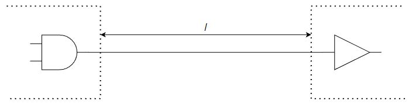
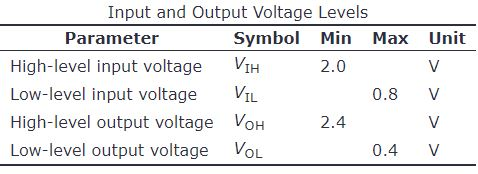

# Problem 844

Consider a digital LVTTL signal from your pedalbox to your main control unit. The length / of the cable inbetween is 5m. Your motor controllers introduce a noise of 0.15 V per meter cable. To correct for that noise, you introduce 74LVC1G34, non-inverting buffers into the cable.\nThe purpose of the buffer is to take a signal, to which a certain amount of noise has been added so that it would no longer meet the input specification of the static discipline, and clean it up so that it once again meets the output specification of the static discipline.\nThe non-inverting LVTTL buffers, as well as the gates shown, obey the following static discipline:\n\nWhat is the minimum number of non-inverting LVTTL buffers required to connect inbetween in oder to ensure correct operation?

