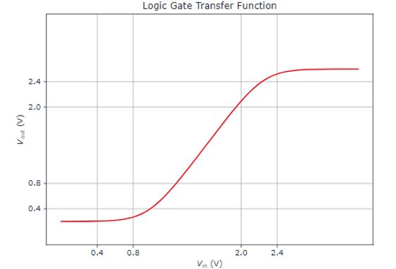
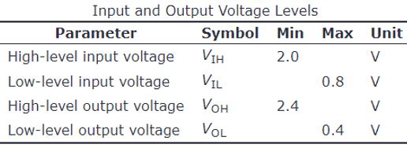

# Problem 845

The figure shows the output voltage Vout versus the input voltage Vin as the transfer function of 74LVC1G34, a non-inverting LVTTL buffer.\nThe non-inverting LVTTL buffer obeys the following static discipline:\n\nDoes the given tranfer curve satisfy the static discipline? Mark all correct answers.

Options:
- A) Yes, it satifies the static dicipline.
- B) No, because the V(OL) is not met for all valid inputs.
- C) No, because the V(OH) is not met for all valid inputs.
